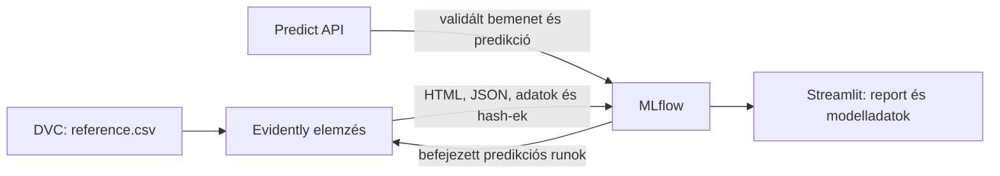

# Ruházati dolgozók produktivitása – MLOps

Az UCI Garment Productivity dataset `actual_productivity` célváltozójának becslése regresszióval.
A cél reprodukálható adatfeldolgozás és egy automatizált, tesztelt MLOps rendszer felépítése.

Elkészült az **1–5. fázis: adatfeldolgozás, modell-életciklus, API, monitoring és automatizált minőségi kapuk**.
Az Evidently reportokat Streamlit jeleníti meg. A Git hookok és GitHub Actions workflow elkészültek;
Airflow és a végső beadási csomag a következő fázis feladatai.

A teljes terv és a követelmények megfeleltetése a [megvalósítási tervben](docs/implementation-plan.md)
olvasható. Az elsődleges követelményforrás a [feladatkiírás](docs/assignment.md), a fázisok rendjét
az [implementációs útmutató](docs/implementation-guidelines.md) tartalmazza.

## AI használata

Codex segít a követelmények feldolgozásában, a kód, tesztek és dokumentáció elkészítésében.
A működést tényleges helyi futtatásokkal és automatizált ellenőrzésekkel igazoljuk.

## Gyors indítás Dockerrel

Előfeltétel a futó Docker Engine és Compose v2, valamint az első image buildhez internetkapcsolat.
WSL esetén a Docker Desktopban az adott disztribúció WSL-integrációja is legyen bekapcsolva.
A repository gyökerében legyen elérhető a `data/garments_worker_productivity.csv` nyers adatfájl;
új klónban ezt DVC-ből, a mellékelt forrásadatokból vagy az alább dokumentált UCI-letöltéssel lehet helyreállítani.
Conda és előre elkészített modell nem szükséges a konténeres induláshoz.

```bash
docker compose up
```

Az image automatikusan felépül a rögzített függőségekkel. Az MLflow egészséges állapota után
az API előállítja a feldolgozott adatokat, és champion hiányában baseline-t és Random Forestet
tanít. A modell tényleges betöltése után indul a HTTP-kiszolgálás. Az első indulás ezért hosszabb.
Ezután a dashboard elkészíti a monitoringreportot. Ha nincs naplózott predikció, 200 megjelölt,
determinista demórekordot küld a valódi API-n keresztül, hogy friss telepítéskor is legyen mit megjeleníteni.
Háttérben, a healthcheckek eredményét megvárva:

```bash
docker compose up -d --wait
docker compose ps
docker compose logs --tail 50 api
```

- [Swagger és kipróbálható API](http://127.0.0.1:8000/docs)
- [Readiness és aktív modellverzió](http://127.0.0.1:8000/health)
- [MLflow Tracking és Model Registry](http://127.0.0.1:5000)
- [Streamlit és Evidently monitoring](http://127.0.0.1:8501)

Portütközés esetén az opcionális `.env` fájl az `.env.example` alapján állítható be.
Alapértelmezésben csak a helyi gépről érhetők el a portok. Mindhárom szolgáltatás nem root
felhasználóval fut, az MLflow egyúttal HTTP-n közvetíti az artifactokat.

| Named volume | Tartalom |
| --- | --- |
| `mlflow-state` | SQLite tracking/Registry adatbázis és modell-, kérés-, predikciós artifactok |
| `api-state` | A tanítás és inicializálás közös zárfájljai |
| `prepared-data` | Feldolgozott adatok, preprocessing és referencia |

A dashboard a feldolgozott adatokat csak olvasható mountból kapja; a reportokat MLflow-ban tárolja.

A `docker compose stop`, `start` és `down` megőrzi a volume-okat. A `down --volumes` törli
az adatbázist és modelleket is. Újraindításkor az adatelőkészítés lefut, de meglévő champion
mellett nincs automatikus újratanítás és nem keletkeznek új modellverziók.
A Docker volume-ok és a gazdagép `runtime/` könyvtára külön állapotot tartalmaznak.

## Fejlesztői környezet

Előfeltételek: Git, Conda, internet a telepítéshez; konténeres ellenőrzéshez Docker és Compose v2.
A minőségi kapukhoz Make és Node.js is szükséges; a CI Node.js 22-t használ,
a helyi futtatás Node.js 20.20.0-val is ellenőrzött. A shell scriptek Linux/WSL környezetre készültek.
A támogatott Python-verzió **3.11.14**. A projekt saját környezetet használ, a Conda base nem módosul.

```bash
conda env create --prefix ./.conda/envs/mlops --file environment.yml
conda activate ./.conda/envs/mlops
python -m pip install --no-build-isolation --no-deps -e .
python -m pip check
garments-fetch-data
make hooks
```

A már naprakész környezetnél csak az aktiválás szükséges; megváltozott függőségeknél a
`python -m pip install -r requirements.txt` parancsot is futtatni kell.
A VS Code interpreter- és tesztbeállításai
a repositoryban vannak. A `requirements.in` a közvetlen, a `requirements.txt` az összes feloldott
függőség pontos verzióját tartalmazza. A pathspec 0.12.1 a DVC scmrepo-kompatibilitása miatt rögzített.

A Linux x86_64 Conda-csomagok pontos visszaállítása alternatív módon:

```bash
conda create --prefix ./.conda/envs/mlops --file conda-linux-64.lock.txt
conda activate ./.conda/envs/mlops
python -m pip install -r requirements.txt
python -m pip install --no-build-isolation --no-deps -e .
```

## Dataset és verziókezelés

Forrás: [UCI Productivity Prediction of Garment Employees](https://archive.ics.uci.edu/dataset/597/productivity+prediction+of+garment+employees),
[DOI: 10.24432/C51S6D](https://doi.org/10.24432/C51S6D). A mellékelt leírás szerint CC BY 4.0 licencű.
1197 rekord, 15 oszlop, 59 nap, 2015-01-01 és 2015-03-11 között.
Az `actual_productivity` regressziós célváltozó. A `wip` 506 helyen hiányzik;
a 37 darab 1 fölötti célértéket és a tört létszámokat megőrizzük.

A nyers CSV és az eredeti dataset-leíró PDF DVC-verziókezelésben van. Gitbe csak a `.dvc`
pointerfájlok kerülnek. A kezdeti remote a Gitből kizárt `.dvc-remote/` helyi könyvtár.

```bash
dvc pull
dvc push
dvc status
```

Új klónba a helyi remote nem érkezik meg: a kapott forrásadatokat be kell másolni, vagy közös,
hozzáférhető DVC remote-ot kell beállítani. A nyers CSV az eredeti UCI-forrásból is helyreállítható:

```bash
garments-fetch-data
```

A letöltés rögzített SHA-256 hash-t ellenőriz. Meglévő, eltérő fájlt nem ír felül; hálózati vagy
integritási hiba esetén nem hoz létre kész CSV-t. Csak a kiválasztott CSV-t olvassa ki a méretkorlátos ZIP-ből.
A dataset-leíró PDF-et ez nem tölti le, azt továbbra is a mellékletből vagy DVC-ből kell biztosítani.
A függőségek telepítése előtt, Python 3.11-gyel is futtatható: `python src/garments_mlops/fetch_data.py`.
Így a CI sem támaszkodik a fejlesztői gép helyi DVC remote-jára.

A fejlesztői gépen a DVC belső cache helye a lokális,
Gitből kizárt konfigurációban `.cache/dvc`; más gépen a DVC alapértelmezése használható.

## Reprodukálható adatfeldolgozás

A becslés az adott napi produktivitást magyarázza. A túlóra, ösztönző és leállás időbeli
rendelkezésre állását napkezdés előtti előrejelzéshez külön tisztázni kellene.

Az aktivált Conda-környezetben:

```bash
dvc repro
dvc repro --force --no-run-cache
dvc push
```

Csak a CSV-ből induló preprocessinghez a `make prepare` használható. Ez a `prepare` DVC stage-et
futtatja, és a kiválasztott Python környezet CLI-jét használja az alfolyamatokban is.

A CLI DVC nélkül is futtatható:

```bash
garments-prepare
garments-prepare --source data/garments_worker_productivity.csv --output /tmp/garments-check --parameters params.yaml
```

A `params.yaml` állítja a teljes napokra számított train és validation arányt és az adatelőkészítés
konfigurációjában rögzített seedet. A felosztás nem véletlen; az azonos napon megfigyelt
munkacsoportok egy halmazban maradnak. A test adatok nem vehetnek részt modellválasztásban.

| Halmaz | Napok | Sorok | Időintervallum |
| --- | ---: | ---: | --- |
| Train | 35 | 711 | 2015-01-01 – 2015-02-10 |
| Validation | 11 | 211 | 2015-02-11 – 2015-02-24 |
| Test | 13 | 275 | 2015-02-25 – 2015-03-11 |

A stateless tisztítás rendezi a dátumformátumot, javítja a részlegneveket, eltávolítja a pontos
duplikációkat és hónap/nap jellemzőket képez. A `team` kategorikus azonosító. Az érvénytelen
sémát, dátumot, negatív vagy végtelen numerikus értéket és hibás targetet elutasítjuk.
A numerikus bemenetek hiányozhatnak; a target nem hiányozhat és nem kerülhet a modell bemenetébe.

A sklearn Pipeline kizárólag a train halmazon illeszti a mediánimputálást, hiányjelzőket,
StandardScalert, kategorikus leggyakoribbérték-imputálást és OneHotEncodert. Ismeretlen kategóriák
és teljesen hiányzó train oszlopok is kezelhetők. A mentett pipeline predikciókor ugyanazt a
tisztítást és transzformációt alkalmazza. A `joblib` artifact csak megbízható forrásból tölthető be.

| Fájl a `data/processed/` alatt | Tartalom |
| --- | --- |
| `cleaned.csv` | Tisztított megfigyelések, target és `split`; a hiányok a tanulásig megmaradnak |
| `train.csv`, `validation.csv`, `test.csv` | Időben elkülönített tisztított adatok |
| `*_transformed.csv` | Trainen illesztett, numerikus jellemzők és target |
| `preprocessed.csv` | A beadáshoz előállított teljes transzformált adat, target és `split` |
| `reference.csv` | Csak a train bemenetei; DVC-verziózott referencia a drift monitoringhoz |
| `preprocessor.joblib` | Illesztett sklearn pipeline |
| `metadata.json` | Bemeneti és kimeneti SHA-256 hash-ek, paraméterek, séma, hiányok, splitadatok |

A 37 numerikus jellemzőt a train adatok határozzák meg. A `metadata.json` az összes többi kimenet
hash-ét tartalmazza; a DVC lock rögzíti a kódot, környezetet, konfigurációt és a teljes eredménykönyvtárat.

## Tanítás, MLflow és Model Registry

A tanítás a `train.csv`, `validation.csv` és `metadata.json` fájlokat használja. Ellenőrzi a tartalmi
hash-eket, a sémát és az időbeli szétválasztást; a végső `test.csv` fájlt nem olvassa be.
A teljes preprocessing és regresszor egyetlen sklearn Pipeline-ként kerül MLflow-ba.

Az aktivált környezetben, a `dvc repro` után:

```bash
export MLFLOW_DISABLE_TELEMETRY=true
export MLFLOW_DISABLE_AGENT_HINT=1
garments-train --model baseline
garments-train --model random_forest
garments-train --model baseline
```

A baseline `DummyRegressor` a train targetátlagát adja vissza. A challenger Random Forest,
alapértelmezetten 100 fával, 8-as maximális mélységgel és 3-as minimális levélmérettel.
A `training.yaml` állítja a tanítás tényleges random seedjét (42), a hiperparamétereket, az
MLflow backendjét, a kísérlet- és modellneveket, valamint a promóciós küszöböt.

A CLI JSON válasza tartalmazza a run ID-t, az új modellverziót, az aktív champion verzióját,
a validációs MAE/RMSE/R² értékeket és a döntés indokát. Minden jelölt külön Registry-verziót kap,
az elutasított modell is visszakereshető marad.

Az első sikeres jelölt automatikusan champion lesz. Később az aktuális championt ugyanazon
validációs adaton újraértékeljük. Promóció akkor történik, ha a jelölt MAE-je szigorúan kisebb,
és a javulás legalább `minimum_improvement` nagyságú. A küszöb abszolút MAE-különbség;
azonos eredmény esetén az alias nem változik.

```bash
garments-train --model random_forest --minimum-improvement 0.005
garments-train --config training.yaml --tracking-uri http://127.0.0.1:5000
```

A `champion` Registry-alias az aktív verzió hiteles forrása. A `load_champion()` minden híváskor
feloldja, majd a kiválasztott verziószámhoz kötve tölti be a modellt; nincs újraindítást igénylő cache.
A közös fájlzár sorosítja a tanításokat és a promóciót. Minden írónak ugyanazt a backend-, modellnév-
és zárkonfigurációt kell használnia. Az adat-előkészítést a tanítás előtt kell befejezni.

Az MLflow rögzíti a paramétereket, train és validation metrikákat, input dataset-referenciákat,
teljes forráshash-eket, inputpéldát és modell-signature-t. Artifactként elérhetők a provenance,
a validációs predikciók és a promóciós döntés. A `promotion_approved` tag a minőségi kapu döntése;
az aktiválást a tényleges alias és a sikeresen befejezett futás igazolja. Tárolási vagy Registry-hiba
esetén a futás `FAILED`, és nem tér vissza sikeres tanítási eredmény.

A modelleket `skops` formátumban mentjük, a saját `FeatureCleaner`, a `numpy.dtype` és a saját
erdő által létrehozott `sklearn.tree._tree.Tree` típusok explicit engedélyezésével. A szükséges
saját kód a modell artifactjába kerül. A Registry és az artifacttároló csak megbízható forrás lehet.

Az MLflow metadata-adatbázisa `runtime/mlflow.db`, artifactjai a `runtime/artifacts/` alatt vannak.
Az ismételt futások megőrzik a korábbi kísérleteket és verziókat. A `runtime/` Gitből kizárt,
ezért klónozáskor nem másolódik át; a modelleket tanítással lehet előállítani. Ez a helyi CLI
alapértelmezése; a Compose az API-t a külön MLflow szolgáltatáshoz kapcsolja.

A helyi CLI futásaihoz külön UI indítható, a Docker 5000-es portja mellett:

```bash
mlflow ui --backend-store-uri sqlite:///runtime/mlflow.db --host 127.0.0.1 --port 5001 --workers 1
```

Elérés: [http://127.0.0.1:5001](http://127.0.0.1:5001). Az Experiments és Models nézetben látszanak
a futások, artifactok, modellverziók és a champion alias.

Az `MLproject` adatelőkészítő és tanító belépési pontot is tartalmaz. A tanító entrypoint kipróbált futtatása:

```bash
MLFLOW_TRACKING_URI=sqlite:///runtime/mlflow.db mlflow run . --env-manager=local --experiment-name garment-productivity-training -e train -P model=random_forest
```

A validációs kapu az automatikus modellcsere minőségét védi. Jövőbeli vagy eltérő eloszlású adatokon
nem garantál változatlan predikciós teljesítményt. A drift monitoring külön folyamat marad.

## REST API és audit

| Végpont | Bemenet / eredmény |
| --- | --- |
| `GET /health` | Registry-elérhetőség és champion alias; kész állapotban 200 és modellverzió, egyébként 503 |
| `POST /predict` | 1–1000 rekord, predikciók, tényleges modellverzió, MLflow run ID és kérésazonosító |
| `POST /train` | `{"model":"random_forest"}` vagy `{"model":"baseline"}`; a `{}` Random Forestet választ |
| `GET /docs`, `GET /openapi.json` | Swagger UI és géppel olvasható szerződés |

Predikciós példa:

```bash
curl --fail-with-body http://127.0.0.1:8000/predict \
  -H 'Content-Type: application/json' \
  -d '{"records":[{"date":"2015-01-01","quarter":"Quarter1","department":"sewing","day":"Thursday","team":8,"targeted_productivity":0.8,"smv":26.16,"wip":1108,"over_time":7080,"incentive":98,"idle_time":0,"idle_men":0,"no_of_style_change":0,"no_of_workers":59}]}'
```

A dátum ISO `YYYY-MM-DD`, a kategóriák megengedett értékei a Swaggerben szerepelnek.
A `team` pozitív egész, a `no_of_style_change` nemnegatív egész; a többi numerikus mező véges,
nemnegatív szám. A tört létszám megengedett, a `wip` elhagyható vagy `null` lehet.
A részlegneveknél a forrásbeli `sweing` és a környező szóközök normalizálódnak.
A target és az ismeretlen mezők elutasításra kerülnek.
A batch opcionális `source` mezője `live` vagy `demo`, alapértelmezése `live`.
A mesterséges forgalmat `"source":"demo"` értékkel kell megjelölni; a monitoring külön kezeli.

```bash
curl --fail-with-body http://127.0.0.1:8000/train \
  -H 'Content-Type: application/json' -d '{"model":"baseline"}'
```

A tanítás szinkron művelet, a válasz csak befejezés után érkezik meg. A szerver konfigurált
adatait és promóciós feltételét használja, ezeket a kliens nem írhatja felül. A válaszban
`status`, `request_id`, `run_id`, `model_version`, `model_uri`, `champion_version`, `metrics`
és `decision` szerepel. Egy gyengébb baseline új verzióként megmarad, de nem cseréli le a championt.
Minden predikció újra feloldja a champion aliast, majd a konkrét verzióval dolgozik.

A hibás bemenet 422, egy másik tanítás által foglalt zár 409, a hiányzó modell vagy nem elérhető
tároló 503 választ ad. Hibás modellkimenet és váratlan belső hiba 500. A hibaválaszok nem
tartalmaznak backendcímet, hitelesítési adatot vagy nyers elutasított bemenetet.
Minden kérés szerver által előállított `X-Request-ID` fejlécet kap; a train/predict válasz és
MLflow run ugyanazzal az azonosítóval kereshető vissza.

A train végpont a modell saját runjába menti az `api/request.json` és `api/response.json`
artifactokat. A predikciók a `garment-productivity-training-requests` kísérlet külön runjaiba
kerülnek, ugyanilyen JSON artifactokkal és `monitoring/current.csv` fájllal. Utóbbi a validált
bemeneteket, predikciókat, kérésazonosítót, modellverziót és a forrás jelölését tartalmazza a monitoringhoz.
Artifactmentési hiba esetén nincs sikeres API-eredmény. A tanítás válasz-artifactját az alias
átállítása előtt mentjük; a tényleges sikert a befejezett run és az alias igazolja.

Az alkalmazás JSON naplósorokban rögzíti a kérésazonosítót, végpontot, metódust, státuszt és
futási időt. A fejlécek, query stringek és elutasított payloadok nem kerülnek ezekbe a naplókba.

Az élő Compose rendszer ellenőrzése az aktivált fejlesztői környezetből:

```bash
garments-smoke --output runtime/smoke.json
```

A smoke teszt ellenőrzi a health, Swagger, OpenAPI, predict, train és hibás batch válaszát,
majd HTTP-n letölti az MLflow artifactokat, és összeveti az API válaszaival. Három rekordra
predikciót készít és egy baseline jelöltet tanít, így valódi új runokat és modellverziót hoz létre.
A JSON eredményfájl Gitből kizárt. Eltérő portokhoz `--api-url` és `--mlflow-url` adható meg.
Az opcionális `--dashboard-url http://127.0.0.1:8501` a Streamlit HTTP-elérését, továbbá a live és
demo reportok natív HTML/JSON artifactjait, a mentett summaryt, sorszámokat és modellverziókat is ellenőrzi.
Ehhez a teljes monitoringrendszer és a demóként jelölt forrás is legyen elérhető.

Docker nélküli API a helyi SQLite-konfigurációval, az aktivált környezetben:

```bash
uvicorn garments_mlops.api:create_app --factory --host 127.0.0.1 --port 8001 --workers 1 --no-access-log
```

Az `MLOPS_TRAINING_CONFIG` másik YAML-t, az `MLFLOW_TRACKING_URI` másik tracking szervert
jelölhet ki. Az `MLOPS_BOOTSTRAP=false` kikapcsolja az automatikus előkészítést és kezdeti tanítást.
Az alapértelmezett helyi rendszer egy API-workert és közös fájlzárat használ. Több gépen futó
tanítókhoz közös koordináció és más adatbázis szükséges. A szolgáltatás helyi fejlesztésre és
bemutatóra készült, autentikáció nincs beállítva.

## Evidently és Streamlit monitoring

A [dashboard](http://127.0.0.1:8501) a train bemeneteit hasonlítja össze a REST API-n keresztül
beérkezett, sikeresen naplózott predikciós bemenetekkel. Az automatikus nézet a `live` adatokat
részesíti előnyben; ezek hiányában a megjelölt demót mutatja. A két forrás külön is kiválasztható,
nem keveredik egy reportban. A „Riport frissítése” gomb az aktuális ablakot újra ellenőrzi;
folyamatos háttérütemezés még nincs. A „Demókérések küldése” gomb új, megjelölt batch-et hoz létre.



A referencia a `data/processed/reference.csv`: kizárólag a train jellemzői, target nélkül.
A beolvasás ellenőrzi a preprocessing metadata fájlban rögzített SHA-256 hash-t.
Az aktuális ablak a legutóbbi 50 sikeres predikciós run közül a kiválasztott forrást tartalmazza,
legfeljebb 5000 sorral, az újabb kérésektől haladva. Egy batch szükség esetén csonkolódik;
az érintett forrásrunok, eredeti artifact-hash-ek és a felhasznált sorok száma a reportban megmaradnak.
Sérült vagy a run azonosítóival nem egyező artifactot nem hagy ki csendben a rendszer.
A korábbi, forrásjelölés nélküli predikciós runokat `live` adatként olvassa.

A stateless tisztítás után 15 modelljellemzőt vizsgálunk: a 9 numerikus és 4 kategorikus bemenetet,
valamint a dátumból képzett hónapot és napot. A `team` kategorikus. A nyers dátum, kérésazonosító,
modellverzió, predikció és target nem driftjellemző. Nincs új imputálás vagy illesztés a current adatokon.

Az Evidently `DataDriftPreset` minden oszlophoz Jensen–Shannon-távolságot számol, 0,1-es küszöbbel.
A dataset jelzése akkor pozitív, ha a vizsgálható oszlopok legalább 50%-a eltérő eloszlású.
Ezek bemutatóhoz választott, rögzített beállítások; nem validált üzemi riasztási határok.
A hiányzó értékek aránya külön szerepel. Ha egy oszlop valamelyik oldalon teljesen hiányzik,
ahhoz nincs eloszlási pontszám; a hiányarány ettől még látható. 100 sornál kisebb current mintánál
a dashboard külön jelzi az eredmény bizonytalanságát.

Az elemzés az MLflow `garment-productivity-training-monitoring` kísérletébe ment:

| Artifact | Tartalom |
| --- | --- |
| `monitoring/report.html` | Interaktív, a dashboardba beágyazott és letölthető Evidently report |
| `monitoring/report.json` | Natív Evidently metrikák és teszteredmények |
| `monitoring/summary.json` | Oszloppontszámok, hiányarányok, adat- és modellverziók, forrásrunok, hash-ek |
| `monitoring/reference.csv`, `monitoring/current.csv` | Az elemzéshez használt két adathalmaz |

A referencia, current ablak, forrásrunok és elemzési beállítások közös fingerprintet kapnak.
Azonos fingerprinthez a korábbi sikeres reportot használjuk, ezért frissítés vagy újraindítás
önmagában nem gyárt új reportot. Artifactmentési hiba esetén a run `FAILED` marad.
Az aktuális championt a dashboard külön kérdezi le, a report pedig rögzíti az elemzéskori aliast
és a predikciókhoz ténylegesen használt verziókat is. A tanítási táblázat a validációs MAE-t
és a promóciós döntést mutatja.

Friss telepítéskor a demó 200 train-referenciából mintázott, 42-es seeddel módosított rekord.
A módosított numerikus értékek szándékosan eltolják az eloszlást. A rekordok a valódi `/predict`
végponton mennek keresztül, `source=demo` jelöléssel; a dashboard jól látható DEMÓ feliratot mutat.
A demó nem jelent új tanítást, és nem használja a test adatokat.

Parancssorból, aktivált fejlesztői környezetben, a helyi CLI SQLite-állapotával:

```bash
garments-monitor --source live
garments-monitor --source demo
garments-monitor --demo-if-empty --api-url http://127.0.0.1:8001
```

A futó Compose rendszerben, annak adataival:

```bash
docker compose exec dashboard garments-monitor --source live
docker compose exec dashboard garments-monitor --source demo
```

A drift kizárólag a bemenetek eloszlásváltozásáról ad információt. Célértékek hiányában nem
mér MAE-t vagy pontosságromlást. Nem tanít új modellt, és nem ír Registry-aliast;
a champion–challenger folyamat továbbra is külön validációs adaton dönt a modellcseréről.

## Minőségellenőrzés

Az aktivált környezetben `make quality`, vagy külön-külön:

```bash
python -m pytest --cov --cov-report=term-missing --cov-report=xml --junitxml=runtime/test-results.xml
python -m coverage report --include='src/*' --fail-under=95
python -m coverage report --include='tests/*' --fail-under=95
python -m flake8 src tests
python -m pyright --pythonpath "$(command -v python)" --warnings
python -m pyright -p pyright-standard.json --pythonpath "$(command -v python)" --warnings
python -m pip check
```

Az src és a tesztkód külön küszöböt kap, mindkettő legalább 95%. Statement és branch coverage is
mérve van, kizárás nélkül. A tesztek a warningokat hibának tekintik, egy MLflow 3.17.2 által
importált, a regresszortól független AI-séma konkrét `AnyType` figyelmeztetésének, illetve az
Evidently régi teszthelperének konkrét `numpy.core` deprekációjának dokumentált kivételével.
Az utóbbi csak a külső `evidently.legacy.tests.utils` modulra érvényes. A saját modell
signature-jét teszt ellenőrzi. A Flake8 sorlimitje 120.
A Pyright alapkonfigurációja az assignment szelíd strict kapcsolóit használja; a másik standard.
Az [1. fázis](docs/phase-1-results.md), [2. fázis](docs/phase-2-results.md),
[3. fázis](docs/phase-3-results.md), [4. fázis](docs/phase-4-results.md), valamint
[5. fázis jelentése](docs/phase-5-results.md) tartalmazza a tényleges eredményeket.
Az 5. fázis végén 281 teszt sikeres; az src statement coverage 100%, branch coverage 99,58%,
az src együttes coverage 99,93%.
A tesztkód statement és branch coverage-e 100%.

## Git hookok és CI

Minden klónban külön telepíteni kell a Git hookokat; a konfiguráció verziózott, a `.git/hooks/` nem:

```bash
make hooks
```

| Esemény | Automatikus ellenőrzés |
| --- | --- |
| `git commit` | Flake8, mindkét Pyright, teljes pytest, külön src/tests coverage-küszöb, `pip check` |
| `git push` | Docker-elérhetőség, Compose-validáció és image build |
| GitHub push, pull request vagy kézi workflow-indítás | Ugyanaz a minőségi hook, majd image build és teljes Compose smoke |

A teljes tesztcsomag commitonként körülbelül 1–3 percet igényelhet. A hosszabb, Docker Engine-et
igénylő build a pre-push hookban fut. A hookok a pontosan rögzített projektfüggőségeket használják;
nincs külön, eltérő verziókkal telepített lintkörnyezet.

A Makefile a projekt `.conda/envs/mlops` interpreterét használja, ha létezik; egyébként a PATH-ban
lévő `python`-t. Más környezet explicit kiválasztható: `make quality PYTHON=/path/to/python`.
A Pyright is ugyanezt az interpretert kapja, ezért a konfiguráció nem kötődik egyetlen helyi venv-útvonalhoz.
Külön parancsok: `make lint`, `make typecheck`, `make test`, `make coverage`, `make docker-build`.

A [CI workflow](.github/workflows/ci.yml) Ubuntu 24.04-en, Python 3.11.14-gyel fut.
Az UCI-adatot hash-ellenőrzéssel állítja helyre, majd a rögzített requirements listát telepíti.
A `quality` job hibája megállítja a folyamatot; a Docker job csak sikeres minőségi kapu után indul.
A használt GitHub Actionök teljes commitazonosítóval rögzítettek, a token csak repository-olvasási jogot kap.
A pytest JUnit XML, coverage XML, illetve a build- és szolgáltatásnaplók GitHub artifactként 14 napig megmaradnak.

A teljes, CI-ben is használt konténeres ellenőrzés helyben:

```bash
make system-smoke
```

Ez egyedi nevű projektet, üres volume-okat és véletlenszerű hostportokat használ. Felépíti az image-et,
megvárja a három szolgáltatás readiness állapotát, majd konténerből teszteli a train/predict API-t,
az MLflow request/response artifactokat, a Streamlitet és a két monitoringforrást.
Az eredmény és naplók a `runtime/system-smoke/garments-check-*/` alatt maradnak meg.
A script kilépéskor a saját konténereit és volume-jait eltávolítja; a fejlesztői projekt adatait megőrzi.
A Docker-parancsok időkorlátosak; takarítási hiba is sikertelen ellenőrzést eredményez.
A CI job timeoutja végső felső korlát, a runner megszűnésekor annak saját környezete is megszűnik.

A hookok elutasító működését is ellenőriztük külön klónban: lint-/típushibás commit, hibás Docker build,
valamint külön-külön 95% alatti src és tesztkód coverage mellett is hibával állnak le a megfelelő kapuk.
GitHub Actions szerveroldali futás még nem történt; az első push után indul automatikusan.
A branch protection és a kötelező státuszellenőrzések beállítása külön GitHub-művelet.

## Felépítés és következő fázisok

| Modul | Felelősség |
| --- | --- |
| `data.py` | Stateless adattisztítás és sémaellenőrzés |
| `splitting.py` | Paramétervalidáció és időrendi felosztás |
| `preprocessing.py` | Újrafelhasználható sklearn transzformációk |
| `prepare.py` | CLI, export és provenance |
| `fetch_data.py` | Rögzített, hash-ellenőrzött nyers adat helyreállítása UCI-ból |
| `modeling.py` | Baseline, Random Forest, metrikák és promóciós feltétel |
| `training_config.py`, `training_data.py` | Validált konfiguráció és ellenőrzött train/validation adatok |
| `tracking.py` | MLflow-kísérlet és verzióhoz kötött champion-feloldás |
| `training.py`, `train_cli.py` | Naplózott tanítás, Registry-promóció és CLI |
| `api_models.py`, `api.py` | Validált HTTP-szerződés, végpontok, korreláció és hibakezelés |
| `bootstrap.py` | Zárolt adatelőkészítés és kezdeti modell létrehozása |
| `prediction.py` | Verzióhoz kötött predikció és MLflow-audit |
| `smoke.py` | Valódi HTTP- és artifact-ellenőrzés, JSON eredményfájl |
| `system_smoke.py` | Streamlit és mindkét monitoringforrás artifactjainak ellenőrzése |
| `monitoring_data.py` | Ellenőrzött referencia és korlátos, külön forrású predikciós ablak |
| `drift.py`, `monitoring.py` | Evidently elemzés, provenance és MLflow-reportok |
| `monitor_cli.py` | Report CLI és megjelölt demókérések |
| `dashboard.py` | Vékony Streamlit megjelenítő |

A baseline és challenger ugyanazon validációs adaton mért MAE alapján versenyeznek. A drift
monitoring külön folyamat, önmagában nem válthat modellt. Airflow a stabil alaprendszer után készül.

A hookok telepítve vannak, a CI workflow definiált, helyi ellenőrzései sikeresek.
A végső UI screenshotok a 6. fázisban készülnek a végleges rendszerről.
A végső ZIP és egyoldalas beadási PDF a 6. fázisban készül, a megadott személyes adatokkal.

## Git munkafolyamat

A projektalapok a `feature/project-foundation`, az adatfeldolgozás a `feature/data-preprocessing`,
a modell-életciklus a `feature/model-training`, az API és Docker a `feature/rest-api`,
a monitoring a `feature/drift-monitoring`, a minőség és CI a `feature/quality-ci` branchen készül.
A mainre a branch-történetet
megőrző `--no-ff` merge-ekkel kerülnek a változások.
A fejlesztési lépéseket és tesztjeiket együtt, angol Conventional Commits üzenetekkel rögzítjük.

```bash
git log --graph --decorate --oneline --all
```

A minimum 50 commit követelmény több fázis tényleges fejlesztésével teljesítendő.
GitHub push, branch protection, az első távoli CI-futtatás igazolása és a közös DVC remote beállítása még hátravan.
